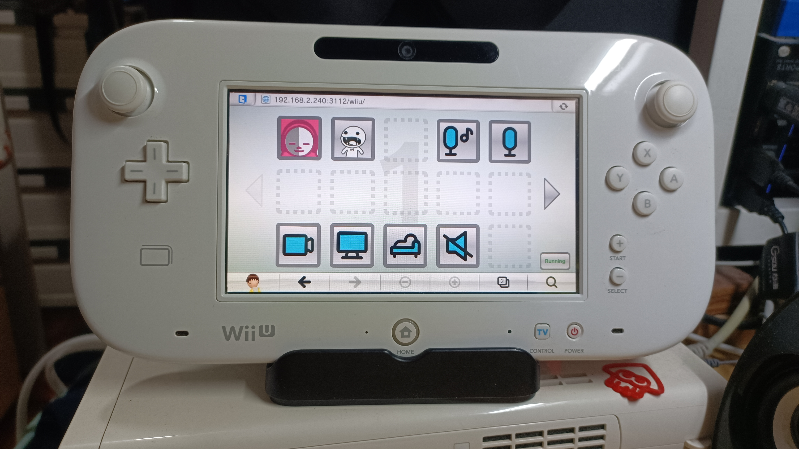
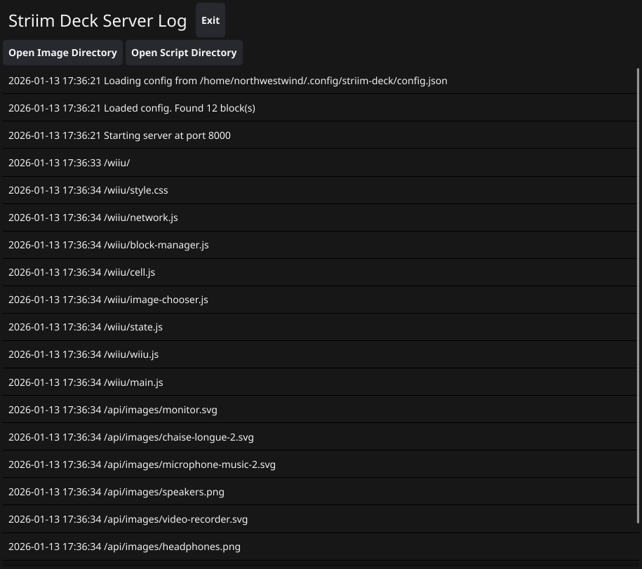

# Striim Deck
Stream deck for the Wii U, utilizing the web browser.

# Video Showcase

# Installation
Download the ZIP file suitable for your operating system (OS) and architecture (arch) from the releases tab. Your choices are:
- Operating Systems
	- Windows
	- MacOS
	- Linux
- Architectures
	- AMD64 (x86_64)
	- ARM64

If you are not sure about your OS and arch, you are probably using Windows + AMD64.  
But in this case, I don't think you can use this program very well...

Extract the ZIP. Make sure the executable is in the same folder as the `client/` folder.  
Other than that requirement, you can place it whereever you want.

I have only tested on Linux AMD64 because that's the only OS I have.
If you run into basic issues such as things not launching please notify me via issues or DM on Matrix or Discord.
[Go ask Integrelle in the Elevator on how to contact me.](https://northwestw.in/info-center)

# Usage
Run the `striim-deck` (or `striim-deck.exe` for Windows users) file.
A GUI will open up which displays the server logs of Striim Deck.
There are also buttons for exiting the program and opening image and script folder.

Striim Deck comes with no images, so you should add your own.  
I recommend going to [SVGRepo](https://www.svgrepo.com/) and just download a multicolor SVG icon pack if you just want a quick start.

## Connecting the Wii U
First, you need to obtain the local IP of your computer.
- On Windows
	1. Open Command Prompt
	2. Type `ipconfig`
	3. Copy the IPv4 Address
- On MacOS
	1. Open System Preferences
	2. Select Network
	3. Select WiFi and your connection
	4. Click on details
	5. Copy the IPv4 Address
- On Linux
	1. Open your favourite terminal emulator
	2. Type `ifconfig`
	3. Copy the IP address following `inet` on the interface of you and your Wii U's LAN
		- If you are wired, look for something like `enp5s0`
		- If you are connected wirelessly, look for something like `wlan0`

Then on your Wii U, open up the Internet Browser and navigate to `http://{ip_address}:3112/wiiu`.
Replace the `{ip_address}` with the IP address you obtained in the last step.
You should be able to see the UI.

If the Wii U browser is stuck at a white screen trying to load, your firewall may be blocking it.
Open up port 3112 for it to function.

### Adding Blocks
1. Use the gamepad joysticks or D-Pad to select an empty block and press A, or alternative, use the stylus or your finger to click on it.
2. You will be prompted to enter a command. Since I don't know what you want to do, you'll have to figure this one out by yourself.
3. Pick an icon for the button. You can use touch or buttons like step 1.
4. A popup will appear on your computer. Click "Accept".
5. You now have a new button!

### Running Blocks
1. Navigate to the block using joysticks or D-Pad and press A, or tap it with a stylus.
2. When the command is running, the background color of the button is flipped.
3. If the command succeeded, the border and background color will turn green for 3 seconds.
4. Otherwise, it will turn red for 3 seconds.

### Deleting Blocks
1. Navigate to the block using joysticks or D-Pad. You cannot use a stylus for this one.
2. Press B
3. Confirm you want to delete the block.

### Moving Blocks
1. In the bottom right corner, there is a button that says "Running". Tap it once to change it to "Moving".
2. Long tap an icon. I recommend moving around slightly on the block so Wii U doesn't open the context menu for image.
3. Drag the block to another location to swap with it, or drag it to the page button to move it to the next page.
4. After you are done, tap the bottom right corner button again to change it back to "Running".

# Building
To build the project yourself, you will need [Node.js](https://nodejs.org) and [Go](https://go.dev).

## `build.sh`
This is a shell script that handles all the building.
Run it with `sh build.sh`.

Binaries will be output to `build/`.

Alternatively, you can compile frontend and backend separately and manually.

## Frontend
All frontend files are inside `client/`.

1. `cd client/`: Change current directory to client
2. `npm install`: Install required packages
3. `node build.js`: Transpile all Typescript files to `dist/`

## Backend
0. You must have frontend transpiled first
1. `go build -o striim-deck *.go`: Build the Go program

## Future Plans
- Add a slider module